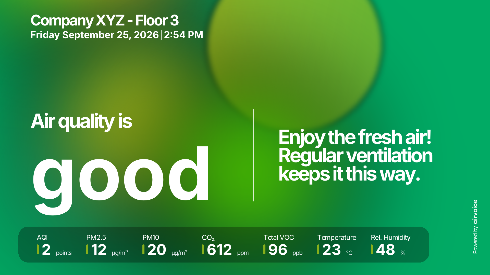
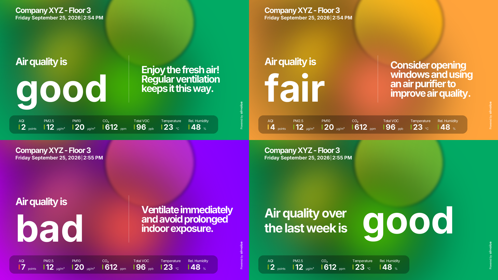
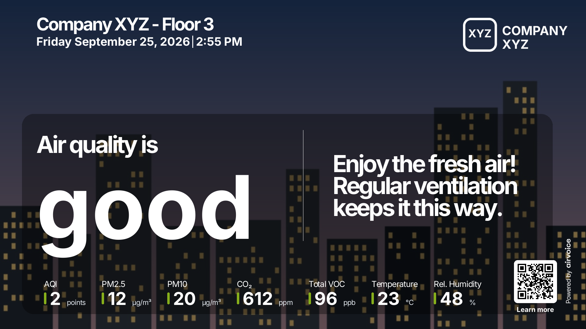
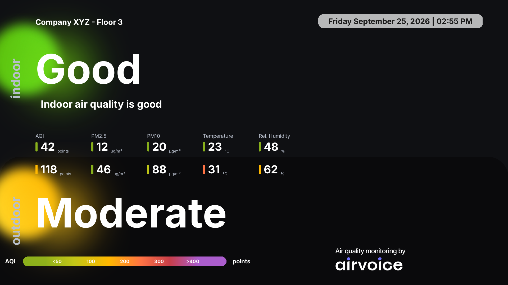
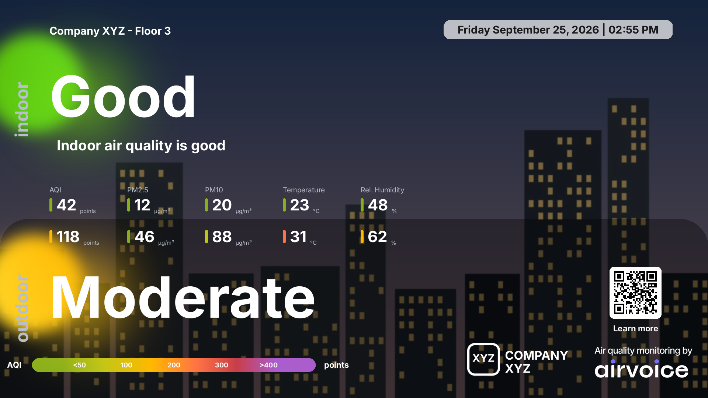

# Airvoice Native Kiosk

> **Version 0.1.0 — testing, not for release.** Bench-tested on one
> Raspberry Pi Zero 2 W. Not yet deployed to any site. Expect changes.
>
> All screenshots in this repo use made-up data ("Company XYZ", invented
> readings, a drawn background, logo and QR code). They are generated by
> `tools/make-demo-images.py`.

A lightweight kiosk that shows an Airvoice air-quality widget
([myindoor.global](https://myindoor.global)) full-screen on a TV, **without a
web browser**. A small Python program reads the widget's JSON API and draws
the screen itself, straight onto the Linux framebuffer.

This is a separate project from the Chromium-based kiosk installer (v1–v9)
and is not a continuation of it.



- **How it's built:** [docs/ARCHITECTURE.md](docs/ARCHITECTURE.md) (diagrams)
- **What changed:** [CHANGELOG.md](CHANGELOG.md)

## What this is for

An office, lobby or factory floor has Airvoice sensors, and a TV on the wall
should show the live indoor air quality, and optionally outdoor air quality,
to everyone passing by. Today that means a Raspberry Pi running a full web
browser pointed at the widget page. It's heavy for a 512 MB device, shows
console text and browser screens while starting, and shows an error page when
the network drops.

This project replaces the browser with a purpose-built program:

1. **Install once:** flash Raspberry Pi OS Lite, connect the Pi to the network
   and the TV, run `install-kiosk.sh`, answer a few questions (which widget,
   which branding, outdoor or not).
2. **Plug and forget:** from then on the Pi starts straight into the client's
   boot image and then the live widget, recovers from network drops and power
   cuts by itself, and keeps logs for remote diagnosis.
3. **Same look as the web widget:** layouts, colours and thresholds are copied
   from the web widget, so the TV matches what clients see in their dashboard.

Planned next: showing the nearest official CPCB station as the outdoor
reading for sites without their own outdoor sensor
([research](docs/cpcb-data-reference.md)).

## What it can do

| Capability | Details |
|---|---|
| Indoor-only layout | Grade word (good / fair / bad) with advice text and every reading the widget has: AQI, PM2.5, PM10, CO₂, Total VOC, temperature, humidity and more |
| Indoor + outdoor layout | Side-by-side comparison with a colour legend on the national AQI scale |
| Client branding | Background photo, logo and QR code, each optional, from the widget's settings or any link or file |
| Grade colours | Green / orange / purple backgrounds; each reading gets a colour tick from the widget's own thresholds |
| Weekly mode | Shows last week's averages outside working hours or when sensors report nothing |
| Offline | Keeps the last good readings on screen and says how old they are |
| Clean boot | Black, then the branded boot image, then the widget; no console text or login prompt |
| Self-healing | Services restart themselves; network watchdog reboots after a long outage |
| Logs | API calls, data freshness, network, nearby WiFi, boot/tamper history, TV power (CEC) |
| Any screen size | Everything is sized from the screen width/height like the web page (tested at 1920×1080) |

## Screens

### Indoor only

No background image: the background colour follows the grade.



*Top: good and fair. Bottom: bad, and weekly-average mode (outside working
hours or when the sensors send nothing).*

With a background image, logo and QR code:



### Indoor + outdoor

Without branding:



With a background image, logo and QR code:



### Boot screen

Built from the same branding: the background image darkened, the logo, and
"Airvoice Display Loading…". Without a logo, the Airvoice logo is used.


## Why no browser

| | Chromium kiosk (v9) | Native kiosk (this) |
|---|---|---|
| RAM in use | ~150–250 MB | ~85 MB |
| What's on screen during boot | console text, then browser | black, then the boot image, then the widget |
| Offline | browser error page | last good readings stay on screen, marked "Last update: over 15 minutes ago" |
| Changes to the web widget's design | picked up automatically | must be copied into this code |

The trade-off is in the last row: this program re-creates the web widget's
design, so when the web widget changes, this code has to follow. The API it
reads is internal to myindoor.global (found by inspecting the web widget's
network traffic), not a published contract.

## How the layout is chosen

- **Indoor only:** `TYPE_INDOOR` widgets, or when the installer is told
  "no outdoor".
- **Indoor + outdoor:** `TYPE_INDOOR_OUTDOOR_CMP` widgets, or when the
  installer is told "yes, outdoor". If the widget has no outdoor station, the
  outdoor panel stays empty (until CPCB support is added).

Both copy the web widget's measurements (sizes, colours, letter-spacing,
thresholds), taken from its code and from the live page. See
[docs/web-widget-reference.md](docs/web-widget-reference.md). Grades and
colours come from each widget's own settings (`aq_settings`, `is_aqi_500`),
so a new site's thresholds work without code changes.

## Client branding

Background photo, client logo and QR code are chosen at install time. For
each one the installer shows what the widget settings already have and asks:

- show it or not, and
- which image: the widget's own, or a different link (`https://…`) or a file
  on the Pi.

A link is downloaded and checked on the spot (a web page instead of an image
is rejected with a clear message). Images are cached on the Pi, so branding
survives reboots and offline periods. If "the widget's own" is chosen, a
change in the myindoor.global dashboard reaches the kiosk automatically
(checked every 30 minutes). SVG logos are converted with `rsvg-convert`.

The boot screen uses the same branding (see the screenshot above).

## Boot sequence

What the screen shows on the bench today:

| Time from power-on | Screen |
|---|---|
| 0 – ~11 s | black (firmware, then kernel; nothing can draw yet) |
| ~11 s | branded boot image |
| ~15 s | brief black blink (~0.2 s) while the display driver switches, then the boot image again |
| ~45 s | live widget |

How:

- `kiosk-splash.service` (root, very early) switches the screen's console to
  graphics mode, so boot messages and the login prompt carry on invisibly,
  then copies a pre-rendered boot image onto the screen. It uses no image
  libraries, so it starts in well under a second.
- `kiosk-console-guard.service` keeps it that way. The login service resets
  the console to text mode when it starts (~45 s), which used to flash the
  login prompt; the guard switches it back within 50 ms and asks the
  renderer to redraw immediately.
- `fbcon=map:1` on the kernel command line keeps kernel text and the
  raspberry logos off the screen from 2 s to 11 s. **Status: tested only
  through `tryboot` so far — not yet in the normal boot line.** See
  "Boot-line changes" below.

### Boot-line changes (read before editing `cmdline.txt`)

Earlier builds removed `console=tty1`, added quiet flags and masked
`getty@tty1`. The device then hung with a blank screen on three reboots.
Rules since then:

- Never remove `console=tty1`, never mask `getty@tty1`.
- One change at a time, tested first with Raspberry Pi's `tryboot`
  (a one-off boot with a test command line; a power cycle returns to normal).
  `tools/boot-test.sh` does this and keeps backups in
  `/boot/firmware/*.orig` and `~/boot-backup/`. `tryboot` is confirmed to
  work on the Pi Zero 2 W.
- The installer does not edit boot files (`APPLY_QUIET_BOOT=false`), apart
  from `disable_splash=1` in `config.txt`.

## Data polling

- The widget's readings update every 5 minutes (`interval` in its settings).
  The API has no "measured at" time, so the kiosk detects an update by the
  values changing.
- Checked every minute on the minute (as the web widget does), plus once
  ~20 s after each expected update, so new numbers appear within seconds.
- A failed call is retried after 15 s, 30 s, then 60 s. Requests time out
  after 20 s.
- `/var/log/kiosk-widget-health.log` records every change in the numbers and
  flags gaps longer than two intervals.

## Install

On a Raspberry Pi running Raspberry Pi OS Trixie Lite (32-bit), already on
the network, as the `pi` user:

```bash
git clone <this repo> ~/airvoice-native-kiosk
cd ~/airvoice-native-kiosk && ./install-kiosk.sh
```

The installer asks for: widget ID and secret key (from the widget URL),
a device label, background / logo / QR code, whether to show an outdoor
section, and whether to enable the HDMI-CEC watchdog. It then installs
packages, the renderer, the watchdogs, scoped sudoers rules, and runs a
self-test.

If the country's Raspbian mirror is down (seen for India), package installs
fall back to `archive.raspbian.org` automatically, without changing the
device's apt settings.

Updating the code on an installed kiosk without re-answering the questions:

```bash
cd ~/airvoice-native-kiosk && git pull && sudo tools/update-renderer.sh
```

## Logs

| File | What |
|---|---|
| `/var/log/kiosk-api.log` | every API call: status, latency |
| `/var/log/kiosk-widget-health.log` | data present/absent, when values last changed, gaps |
| `/var/log/kiosk-net-watchdog.log` | health of every connected network (Ethernet and/or WiFi) |
| `/var/log/kiosk-wifi-scan.log` | nearby WiFi networks (only on WiFi devices) |
| `/var/log/kiosk-tamper.log` | every boot, tagged expected / unexpected |
| `/var/log/pi-cec-watchdog.log` | TV power and input (only if CEC is enabled) |
| `journalctl -u kiosk-splash -u kiosk-console-guard` | boot screen timings, console resets |

## Project layout

```
install-kiosk.sh              installer (11 steps)
kiosk-renderer.service        the renderer, runs as pi
kiosk-splash.service          early boot image (root, oneshot)
kiosk-console-guard.service   keeps the console in graphics mode (root)
renderer/
  kiosk_renderer.py           main loop, framebuffer output, indoor+outdoor layout, boot screen
  indoor_layout.py            indoor-only layout
  widget_rules.py             which readings to show, formatting, grades and colours
  api_client.py               polling, snapshot cache, API and health logs
  client_assets.py            background/logo/QR download and cache
  kiosk_splash.py             boot image + console guard (no heavy imports)
  setup_helper.py             installer helper (standard library only)
  fb_snapshot.py              screenshot of the real screen, for testing
  assets/                     fonts, Airvoice marks
watchdogs/                    network, WiFi scan, tamper/restart, HDMI-CEC
tools/
  boot-test.sh                test a kernel command-line change with tryboot
  update-renderer.sh          push new code to an installed kiosk
  make-demo-images.py         regenerate the screenshots in docs/images (made-up data)
offline-packages/             script to build an offline .deb bundle (bundle itself not in git)
docs/                         ARCHITECTURE.md, research notes, screenshots
```

## Known issues and open work (v0.1)

- `fbcon=map:1` not yet in the normal boot line (waiting for approval, then
  3 warm + 3 cold reboot checks).
- ~0.2 s black blink at ~15 s when the display driver switches; can't be
  removed from userspace.
- Outdoor section with no outdoor station shows empty values. CPCB station
  data (via data.gov.in) is researched but not built:
  [docs/cpcb-data-reference.md](docs/cpcb-data-reference.md).
- Tamper log labels a clean `sudo reboot` as unexpected.
- The offline package bundle is out of date (needs rebuilding for the
  current package list).
- The WiFi address on the bench Pi sometimes conflicts in DHCP.
- `TYPE_INDOOR_OUTDOOR` (non-comparison) widgets use the comparison layout;
  the web widget has a different design for them.
- Tested on one Pi Zero 2 W at 1920×1080 only.

See [CHANGELOG.md](CHANGELOG.md).
