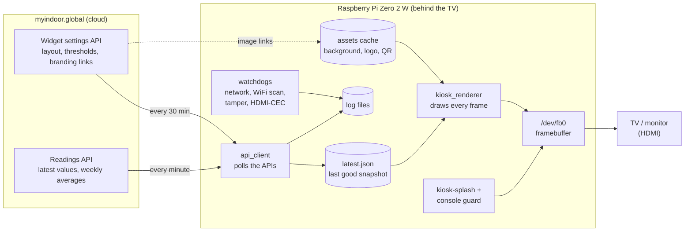
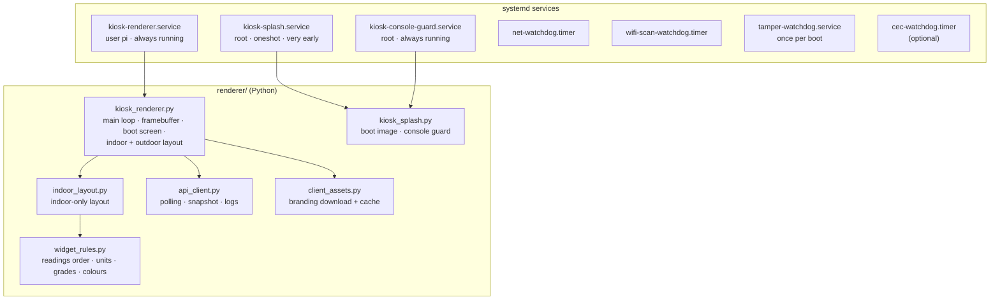
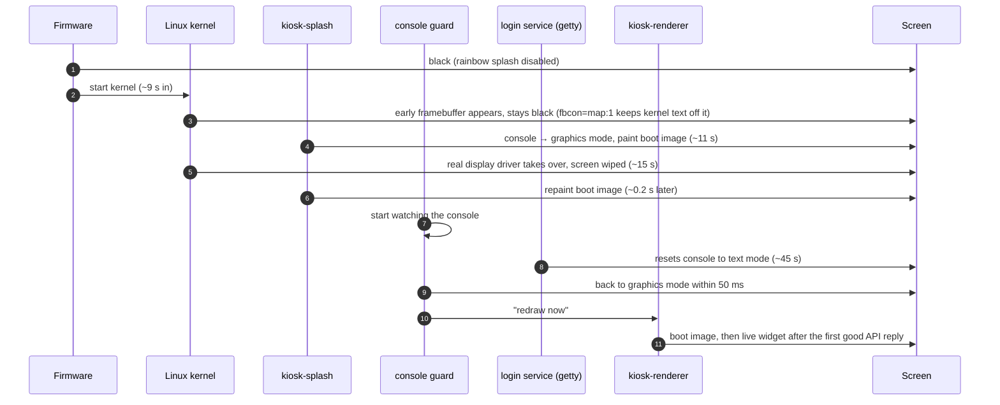
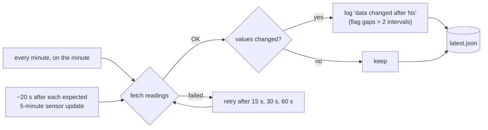
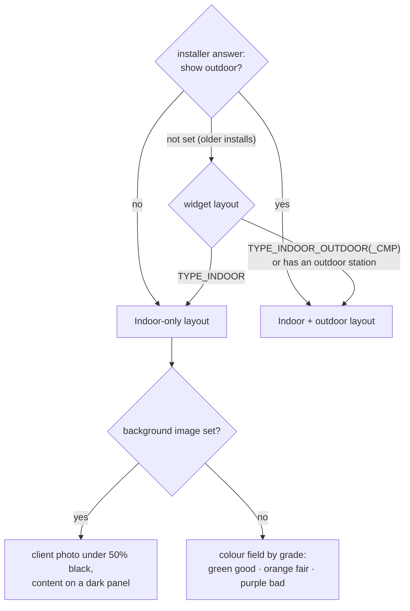
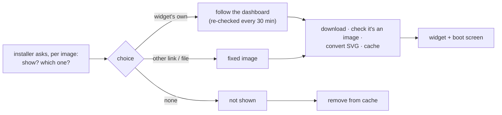
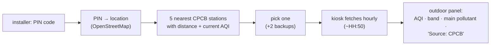

# Architecture

How the kiosk is put together, how data moves through it, and what happens
from power-on to the live screen. Diagrams render on GitHub; the source is
plain text in this file.

## 1. The big picture

One small computer behind the TV, one program drawing the screen, a handful
of small helper services around it. There is no browser, window manager or
desktop.

- **The kiosk only reads.** It never sends data to myindoor.global; it
  fetches the same two JSON endpoints the web widget uses.
- **The snapshot file decouples network from screen.** A slow or dead network
  never freezes the display: the renderer always draws from the last good
  snapshot on disk, which also survives reboots.
- **Branding is cached locally.** Images are downloaded once and reused, so
  the kiosk keeps its look offline.

## 2. Software components

| Piece | Runs as | Job |
|---|---|---|
| `kiosk-renderer` | `pi` | Draws the screen about once a second; runs the API poller in a background thread; downloads branding in the background when it changes. |
| `kiosk-splash` | root, once | Hides the text console and paints the boot image as early as possible. Imports nothing heavy, so it's ready in under a second. |
| `kiosk-console-guard` | root, always | Keeps the console in graphics mode for the whole uptime (the login service resets it at ~45 s). |
| watchdogs | root, timers | Network health (reboots after a long outage), nearby WiFi log, boot/tamper history, optional TV wake over HDMI-CEC. |

Root is used only where Linux requires it (the console device is root-only).
The renderer itself runs as the unprivileged `pi` user, with scoped sudoers
rules for exactly two commands (restart the renderer, reboot).

## 3. From power-on to live screen

The boot image is pre-rendered by the renderer into raw framebuffer files
(one for the early 32-bit framebuffer, one for the real 16-bit one), so the
splash only has to copy bytes.

## 4. Where the data comes from and how often

- The API gives no "measured at" time, so an update is recognised by the
  numbers changing; the kiosk learns the rhythm from that.
- If every live value is empty, or it's outside working hours, the screen
  shows last week's averages instead (same rule as the web widget).
- After 15 minutes without a successful reply, the screen adds
  "Last update: over 15 minutes ago" (and "over 1 hour ago" later).

## 5. Choosing what to draw

Grades and colours come from the widget's own settings:

- **Overall grade** (good / fair / bad) from the widget's main species
  (usually AQI) and its two thresholds.
- **Each reading's colour tick** from that species' own thresholds, e.g.
  temperature is good in the middle band and fair/poor on both sides.
- Widgets on the national 0–500 AQI scale (`is_aqi_500`) use the fixed
  national thresholds instead.

## 6. Branding

## 7. Safety rules built into the design

- **Boot files are touched as little as possible.** The only boot-line
  change is one added word, `fbcon=map:1`. It was proven with Raspberry Pi's
  `tryboot` first (one test boot; a power cycle returns to normal), then made
  permanent; the original is kept as `cmdline.txt.orig`. `console=tty1` is
  never removed and the login service is never disabled; those changes
  caused hangs in earlier builds.
- **Everything restarts itself.** The renderer and the guard restart
  automatically if they ever exit; the network watchdog reboots the Pi after
  a long outage and tags that reboot so it isn't mistaken for tampering.
- **Nothing depends on the network to show something.** Offline, the screen
  keeps the last good readings and says how old they are.

## 8. Planned: CPCB outdoor data

For widgets without their own outdoor station, the outdoor panel can show the
nearest official CPCB monitoring station, from the Government of India
open-data API (data.gov.in). Research is done, not built yet: see
[cpcb-data-reference.md](cpcb-data-reference.md).

